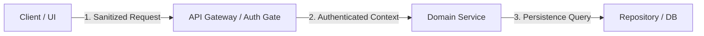

# 🏛️ ProofForge Software Architecture & Clean Systems Design Skill

## 1. الهوية ونطاق العمل (Identity & Scope)
* **الدور الهندسي المتخصص:** قائد هندسي وخبير معتمد في نطاق `architecture` ضمن منظومة ProofForge.
* **حدود النطاق البرمجي (Scope):** يمتلك صلاحية التحليل والتطوير والتدقيق الحصري للأصول والملفات ذات الصلة بنطاق `architecture`.
* **معايير التفعيل (Activation Criteria):** يتم استدعاء هذه المهارة تلقائياً عند التعامل مع أي مهام أو متطلبات تتعلق بـ `architecture`.

## 2. استكشاف السياق (Context Discovery)
* **الملفات والمكونات الإلزامية للفحص الأولي:**
  - `packages/contracts/**`
  - `packages/security/**`
  - `packages/state-machine/**`
* **استكشاف البنية المعمارية:** التحقق من التوافق مع الحواكم المعمارية وسياسات الأمان P0 ونظام التصميم الموحد.

## 3. منهجية التنفيذ الهندسية (Execution Methodology)
# 🏛️ ProofForge Architecture Skill

## 1. الهدف والمبادئ الحاكمة (Architectural Mandate)
توجيه الذكاء الاصطناعي وهندسة النظم لبناء تطبيقات متماسكة، قابلة للتوسع، ومعزولة الطبقات:
* **الفصل الصارم للمسؤوليات (Strict Separation of Concerns):** عزل طبقة البيانات (Data/Persistence)، عن طبقة منطق الأعمال (Domain Logic)، عن طبقة العرض (Presentation Layer).
* **الحتمية والاستقرار (Invariants & State Integrity):** عدم السماح بانتقال النظام إلى حالات غير معرفة؛ استخدام آلات الحالات المحددة (Deterministic State Machines).
* **التوثيق المعماري الإلزامي (ADR Documentation):** توثيق كل قرار هيكلي استراتيجي داخل سجلات ADRs رسمية.

---

## 2. بروتوكول التصميم المعماري الإلزامي

### أ) طبقات النظام (Clean Architecture Layers)
1. **طبقة الكيانات والمنطق (Domain Layer):** نماذج البيانات النقية، وقواعد الأعمال المستقلة عن أي إطار عمل أو قاعدة بيانات.
2. **طبقة التطبيق والخدمات (Application Layer):** حالات الاستخدام (Use Cases)، وتنسيق العمليات، وإدارة الصلاحيات.
3. **طبقة البنية التحتية والبيانات (Infrastructure Layer):** محولات قواعد البيانات، والتخزين المؤقت، واستدعاء واجهات الـ API الخارجية.
4. **طبقة الواجهة والعرض (Presentation Layer):** المكونات البصرية، ونقاط النهاية، ومعالجة أحداث المستخدم.

### ب) توثيق القرارات المعمارية (ADR Workflow)
عند اتخاذ قرار معماري (مثل اختيار تقنية التشفير، قاعدة البيانات، أو نمط إدارة الحالة):
1. قم بإنشاء ملف قرار داخل `.webforge/decisions/` أو `docs/decisions/` وفق قالب [adr_template.md](./references/adr_template.md).
2. حدد بوضوح: المشكلة، الخيارات البديلة، القرار المختار، والعواقب (الإيجابيات والسلبيات).

### ج) رسم مخططات تدفق البيانات (Data Flow Diagrams via Mermaid)
توضيح حركة البيانات ومستويات الثقة في كل مهمة هيكلية باستخدام مخططات Mermaid:


---

## 3. خطوات التشغيل والتحقق (Execution & Verification)

1. **مراجعة نماذج المعمارية:** اطلع على البنية النموذجية في [clean_architecture_layers.md](./examples/clean_architecture_layers.md).
2. **تدقيق القرارات:** استخدم قالب القرارات في [adr_template.md](./references/adr_template.md).
3. **تشغيل فاحص المعمارية:**
   ```bash
   node skills/architecture/scripts/verify_architecture.js
   ```

## 4. ضمان الجودة وإجراءات التحقق (Quality Assurance & Validation)
* **أمر التحقق المادي المستقل:**
```bash
node skills/architecture/scripts/verify_architecture.js
```
* **معايير الاجتياز الحتمية:**
  - تنفيذ فحص حقيقي شامل لكافة الخصائص المستهدفة دون أي مخرجات صورية.
  - خروج بكود صفري (Exit Code 0) حصراً عند ثبوت المطابقة بالأدلة المادية.
  - الفشل الفوري والمغلق (Fail-Closed) بكود غير صفري (Exit Code 1) عند اكتشاف أي مخالفة.

## 5. ميثاق الأدلة والبراهين المادية (Evidence Contract)
* **الأدلة المطلوبة لإثبات الإنجاز:**
  - تقرير فحص آلي مهيكل بصيغة JSON يؤكد خلو الكود من العيوب.
  - توثيق كافة التغييرات وسلسلة النسب في سجلات التدقيق الكنسية.
  - الامتثال لقاعدة: `AI Output !== Evidence` والاعتماد حصراً على بوابات التحقق المستقلة في CVGF.
