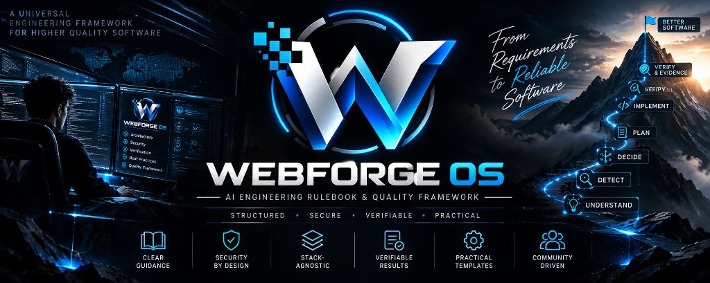
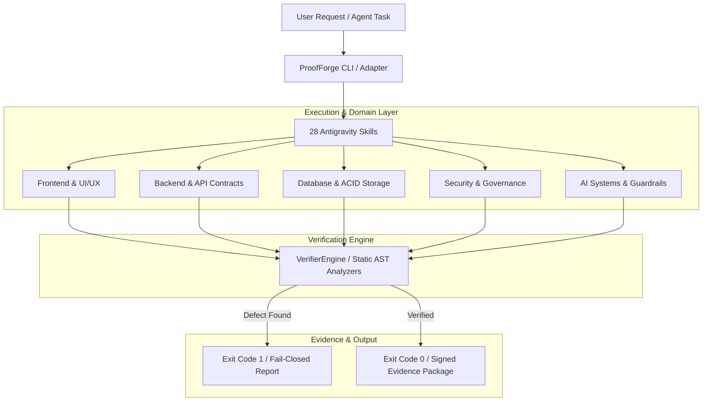

<div align="center">



# ProofForge

### Deterministic AI Engineering Verification & Governance Framework

**Build with AI. Verify with Evidence.**

A deterministic, fail-closed engineering and verification ecosystem optimized for **Google Antigravity** and modern AI coding agents. ProofForge enforces mathematical proof over unverified assertion, validates security invariants, eliminates AI slop and placeholder code, and provides 28 specialized, machine-auditable engineering skills.

[](https://github.com/EyadAbduljalil/ProofForge/releases/tag/v2.0.0)
[](skills/)
[](skills/security/references/security_matrix.md)
[](package.json)
[](LICENSE)
[](https://github.com/EyadAbduljalil/ProofForge/actions)

**Repository:** [github.com/EyadAbduljalil/ProofForge](https://github.com/EyadAbduljalil/ProofForge) &nbsp;|&nbsp; **Architecture Guide:** [`docs/WORKFLOW_COORDINATION.md`](docs/WORKFLOW_COORDINATION.md)

</div>

---

## 📌 Table of Contents

- [⚡ One-Click AI Skills Adoption Directive](#-one-click-ai-skills-adoption-directive)
- [Overview](#-overview)
- [Key Features](#-key-features)
- [System Architecture](#-system-architecture)
- [The 28 Antigravity Engineering Skills](#-the-28-antigravity-engineering-skills)
- [Verification Model & Evidence Contract](#-verification-model--evidence-contract)
- [Installation & Quick Start](#-installation--quick-start)
- [CLI Reference](#-cli-reference)
- [Programmatic API](#-programmatic-api)
- [Project Structure](#-project-structure)
- [Configuration & Environment](#-configuration--environment)
- [Testing & Quality Assurance](#-testing--quality-assurance)
- [Realistic Scenario Benchmarks](#-realistic-scenario-benchmarks)
- [Roadmap](#-roadmap)
- [Contributing & Governance](#-contributing--governance)
- [License](#-license)

---

## ⚡ One-Click AI Skills Adoption Directive

> 💡 **For Google Antigravity, Claude Code, Cursor, Windsurf, Codex, and ChatGPT:**  
> Copy and send this prompt to your AI coding agent to immediately adopt ProofForge's 28 engineering skills, deterministic verification gates, and OWASP ASVS L2 security governance in **any** project:

```text
================================================================================
           PROOFFORGE V2 — ONE-CLICK AGENT SKILLS ADOPTION DIRECTIVE
================================================================================
You are the Lead Software & Security Architect for this workspace, governed by ProofForge.

MANDATORY FIRST STEP:
Clone and activate the official ProofForge 28 engineering skills suite:
git clone https://github.com/EyadAbduljalil/ProofForge.git .proofforge && npx proofforge skills sync

CORE GOVERNANCE RULES (FAIL-CLOSED):
1. [Security (P0)]: Zero-trust, server-side authorization, anti-IDOR/BOLA, sanitize I/O, validate tenant_id on all queries, timing-safe crypto, and default-deny.
2. [Evidence Contract]: Never claim completion without deterministic machine evidence (terminal exit code 0). No unverified claims or assumed passes.
3. [Anti-Laziness]: Strictly no "// TODO: implement later", no placeholder comments, no truncated implementations, no mock bypasses. Deliver 100% complete production code.
4. [Anti-Slop Craft]: Ban generic AI purple gradients, bloated card grids, and fake metrics. Enforce 4px/8px spatial rhythm, WCAG AAA contrast, semantic tokens, and RTL/LTR parity.
5. [Architecture]: Strict separation of concerns (Clean Architecture). Decouple presentation from storage. Enforce ACID transactions for all multi-step state mutations.

ACTIVE SKILL ACTIVATION:
Whenever working on a task, automatically invoke the relevant specialized ProofForge skill:
- Frontend / UX: skills/frontend, skills/forms, skills/ui-ux, skills/responsive, skills/rtl
- Backend / API: skills/backend, skills/api, skills/database, skills/ecommerce
- Quality & Verification: skills/testing, skills/code-review, skills/anti-laziness, skills/project-audit
- Performance / Polish: skills/performance, skills/motion, skills/taste-craft, skills/anti-slop, skills/design-system
- Security & SRE: skills/security, skills/production-readiness, skills/deployment, skills/architecture, skills/seo
- AI Systems: skills/ai-engineering

VERIFICATION OBLIGATION:
Before reporting any task as done, you MUST execute the corresponding verification script:
e.g. node .proofforge/bin/proofforge.js verify
If any check fails (exit code 1), fix the root cause immediately. Conclude every response with:
1. Security Summary & Trust Boundaries
2. Exact Changes Made (Minimal Safe Diffs)
3. Verifiable Terminal Output / Evidence
================================================================================
```

---

## 💡 Overview

Modern generative AI assistants write code at blistering speed, but production engineering environments cannot rely on unverified claims. AI-generated solutions frequently suffer from:

1. **Unverified Claims:** Declaring tasks "complete" without executing real tests, leaving unhandled edge cases.
2. **Subtle Security Flaws:** Introducing Broken Object Level Authorization (BOLA/IDOR), missing rate limits, and client-trusted inputs.
3. **AI Slop & Laziness:** Generating generic purple gradients, bloated card grids, and leaving `// TODO: implement later` mocks.

**ProofForge solves this by establishing a deterministic, fail-closed verification layer.**

Instead of blindly trusting model output, ProofForge bridges the gap between natural language prompts and verifiable production code. Every engineering change must satisfy automated, terminal-backed checks, strict AST inspection, and runtime evidence before being marked as verified.

```
AI Prompt / Task ──> ProofForge Skill ──> Automated Verifier Engine ──> Deterministic Evidence (Pass/Fail)
```

---

## ✨ Key Features

### 🛡️ P0 Security & OWASP ASVS Level 2
* **Server-Side Enforcement:** Zero trust toward client controls; mandatory server-side parameter validation and role checks.
* **Anti-IDOR & Multi-Tenancy:** Hardened ownership validation ensuring every query and mutation is scoped by `tenant_id`.
* **Safe Cryptography:** Constant-time hash verification, timing-safe webhook HMAC checks, and automatic secret scrubbing in audit logs.

### 🧪 Deterministic Verifier Engine (Fail-Closed)
* **Real Static & AST Inspection:** Zero hardcoded success messages; every verifier scans actual project files using AST and regex inspectors.
* **Strict Exit Code Semantics:** Verifiers exit with code `0` solely when properties are proven; any flaw immediately produces exit code `1`.
* **Zero Lazy Placeholders:** Scans codebases to block `// TODO`, `/* FIXME */`, and empty catch blocks.

### 🎨 Anti-Slop Visual Intelligence & BiDi Parity
* **Restrained Craft:** Rejects repetitive AI design tropes (excessive purple gradients, fake metric cards) in favor of semantic design tokens.
* **4px/8px Spatial Rhythm:** Enforces consistent typography scales, subtle borders, and accessible color contrast (WCAG AAA).
* **RTL/LTR Parity:** First-class support for Arabic and bidirectional interfaces using CSS logical properties (`ms-`, `me-`, `inline-start`).

### 🤖 Google Antigravity Native Integration
* **Canonical Synchronization:** Synchronizes modular skills directly into `.agents/skills/` with clean `lowercase-hyphenated` frontmatter.
* **Progressive Disclosure:** Structured into `SKILL.md`, `scripts/`, `examples/`, and `references/` for efficient agent context utilization.
* **Safe Differential Pruning:** Safely updates core framework skills while protecting custom user-defined skills.

---

## 🏛️ System Architecture

ProofForge is organized into decoupled, specialized modules governed by a centralized verification pipeline:



---

## 🛡️ The 28 Antigravity Engineering Skills

ProofForge provides **28 specialized, production-ready skills** mapped across the 8 core engineering disciplines. Each skill implements the **5-Part Skill Quality Contract** (Identity & Scope, Context Discovery, Execution Methodology, Quality Assurance, Evidence Contract).

### 1. Frontend Engineering
| Skill | Description | Automated Verifier |
|---|---|---|
| [`frontend`](skills/frontend/SKILL.md) | Client-side state architecture, error boundary containment, and chunk splitting. | `node skills/frontend/scripts/verify_frontend.js` |
| [`forms`](skills/forms/SKILL.md) | Schema-validated forms (Zod), double-submission prevention, and accessible errors. | `node skills/forms/scripts/verify_forms.js` |
| [`ui-ux`](skills/ui-ux/SKILL.md) | Resilient 5-state UI machines (Idle, Loading, Empty, Error, Success). | `node skills/ui-ux/scripts/verify_ux.js` |
| [`responsive`](skills/responsive/SKILL.md) | Mobile-first layouts (320px to 4K), 44x44px touch targets, zero horizontal scroll. | `node skills/responsive/scripts/verify_responsive.js` |
| [`rtl`](skills/rtl/SKILL.md) | Arabic and Hebrew bidirectional layouts, CSS logical properties, icon mirroring. | `node skills/rtl/scripts/audit_rtl.js` |
| [`dashboards`](skills/dashboards/SKILL.md) | High-density data dashboards, real-time metrics, and virtualized tables. | `node skills/dashboards/scripts/verify_dashboards.js` |

### 2. Backend Engineering
| Skill | Description | Automated Verifier |
|---|---|---|
| [`backend`](skills/backend/SKILL.md) | Express/Node.js architecture, `/healthz` & `/readyz` probes, and rate-limiting. | `node skills/backend/scripts/verify_backend.js` |
| [`api`](skills/api/SKILL.md) | REST/GraphQL contracts, standardized response envelopes, and idempotent mutations. | `node skills/api/scripts/verify_api.js` |

### 3. Database Engineering
| Skill | Description | Automated Verifier |
|---|---|---|
| [`database`](skills/database/SKILL.md) | Relational/NoSQL schemas, multi-tenant isolation (`tenant_id`), and ACID transactions. | `node skills/database/scripts/verify_database.js` |

### 4. Full-Stack & Feature Engineering
| Skill | Description | Automated Verifier |
|---|---|---|
| [`fullstack`](skills/fullstack/SKILL.md) | End-to-end feature lifecycles, API-to-DB integration, and cross-tier invariants. | `node skills/fullstack/scripts/verify_fullstack.js` |
| [`ecommerce`](skills/ecommerce/SKILL.md) | Atomic inventory locks, double-spend prevention, and timing-safe webhook HMAC. | `node skills/ecommerce/scripts/verify_ecommerce.js` |
| [`image-to-code`](skills/image-to-code/SKILL.md) | Transforming UI designs to production Tailwind/React without hallucination. | `node skills/image-to-code/scripts/verify_image_code.js` |

### 5. Software Quality & Verification
| Skill | Description | Automated Verifier |
|---|---|---|
| [`testing`](skills/testing/SKILL.md) | Deterministic unit/integration/E2E test suites, fuzzing, and Evidence Contracts. | `node skills/testing/scripts/verify_evidence.js` |
| [`code-review`](skills/code-review/SKILL.md) | Adversarial code review, vulnerability detection, and regression analysis. | `node skills/code-review/scripts/review_code.js` |
| [`anti-laziness`](skills/anti-laziness/SKILL.md) | Scanning and banning `// TODO` placeholders, mocked logic, and truncation. | `node skills/anti-laziness/scripts/scan_laziness.js` |
| [`project-audit`](skills/project-audit/SKILL.md) | Composite multi-domain diagnostic executing 14 real verification engines. | `node skills/project-audit/scripts/run_audit.js` |

### 6. Performance & Visual Craft
| Skill | Description | Automated Verifier |
|---|---|---|
| [`performance`](skills/performance/SKILL.md) | Google Core Web Vitals optimization (< 2.5s LCP, < 200ms INP, < 0.1 CLS). | `node skills/performance/scripts/audit_performance.js` |
| [`motion`](skills/motion/SKILL.md) | 60fps GPU-accelerated transforms, zero layout reflows, and reduced-motion support. | `node skills/motion/scripts/audit_motion.js` |
| [`taste-craft`](skills/taste-craft/SKILL.md) | High tactile polish, micro-interactions, active states, and refined typography. | `node skills/taste-craft/scripts/audit_craft.js` |
| [`anti-slop`](skills/anti-slop/SKILL.md) | Banning generic purple gradients, bloated cards, and fake trust badges. | `node skills/anti-slop/scripts/audit_slop.js` |
| [`design-system`](skills/design-system/SKILL.md) | CSS design tokens, 4px/8px spatial rhythm, and WCAG AAA contrast scales. | `node skills/design-system/scripts/verify_tokens.js` |

### 7. DevOps & Production Reliability
| Skill | Description | Automated Verifier |
|---|---|---|
| [`accessibility`](skills/accessibility/SKILL.md) | WCAG 2.2 AA/AAA compliance, screen reader ARIA labels, and focus traps. | `node skills/accessibility/scripts/audit_a11y.js` |
| [`security`](skills/security/SKILL.md) | OWASP ASVS L2 verification, anti-IDOR checks, and cryptographic storage. | `node skills/security/scripts/verify_security.js` |
| [`deployment`](skills/deployment/SKILL.md) | Multi-stage non-root Dockerfiles, reproducible builds, and zero leaked secrets. | `node skills/deployment/scripts/verify_deployment.js` |
| [`production-readiness`](skills/production-readiness/SKILL.md) | 12-Factor principles, structured JSON logging, and container health probes. | `node skills/production-readiness/scripts/audit_readiness.js` |
| [`architecture`](skills/architecture/SKILL.md) | Clean Architecture boundaries, domain invariants, and Architecture Decision Records. | `node skills/architecture/scripts/verify_architecture.js` |
| [`seo`](skills/seo/SKILL.md) | Semantic HTML5 structure, OpenGraph protocols, and JSON-LD schema markup. | `node skills/seo/scripts/verify_seo.js` |

### 8. AI Engineering & Agent Systems
| Skill | Description | Automated Verifier |
|---|---|---|
| [`ai-engineering`](skills/ai-engineering/SKILL.md) | AI agent tool governance, prompt injection defense, and structured JSON schemas. | `node skills/ai-engineering/scripts/verify_ai_engineering.js` |

---

## 🔬 Verification Model & Evidence Contract

ProofForge strictly enforces a 5-tier evidence hierarchy. Natural language claims alone are untrusted:

```
[State 0] AI_CLAIMED         → Agent claims a bug is fixed (Untrusted / Rejected)
    ↓
[State 1] CODE_CHANGED       → File modification verified on disk via AST inspection
    ↓
[State 2] TEST_PASSED        → Automated test suite passes with exit code 0
    ↓
[State 3] EVIDENCE_CAPTURED  → Real terminal output and file diffs recorded
    ↓
[State 4] PROOFFORGE_VERIFIED → Validated against domain contract and machine-certified
```

**Fail-Closed Rule:** If any check fails, the process exits with `code 1`. The agent must remediate the actual root cause instead of claiming completion.

---

## 🚀 Installation & Quick Start

### Prerequisites
* **Node.js:** `>= 18.0.0`
* **Package Manager:** `npm` (bundled with Node.js)
* **Git:** Installed and available on system `PATH`

### 1. Clone the Repository
```bash
git clone https://github.com/EyadAbduljalil/ProofForge.git
cd ProofForge
```

### 2. Install Dependencies
```bash
npm install
```

### 3. Verify Framework Integrity
Execute the comprehensive test suite to confirm all 14 security and orchestration packages pass:
```bash
npm test
```

### 4. Run the Project Audit
Audit your codebase using the multi-domain verification runner:
```bash
npm run verify
```

### 5. Synchronize & Activate Skills in Google Antigravity
To install and activate all 28 canonical skills into your Antigravity workspace:
```bash
node bin/proofforge.js skills sync
```
This deploys the 28 validated skills directly into `.agents/skills/` where Google Antigravity discovers and progressively loads them as needed.

---

## 💻 CLI Reference

ProofForge includes a unified command-line interface under `proofforge` (and `webforge`):

### Skill Management Commands

```bash
# List all 28 canonical engineering skills and their verification status
node bin/proofforge.js skills list

# Inspect a specific skill's frontmatter, scripts, and examples
node bin/proofforge.js skills inspect frontend

# Validate structural integrity and Antigravity specification compliance
node bin/proofforge.js skills validate

# Execute the automated 28-skill quality benchmark
node bin/proofforge.js skills benchmark

# Synchronize canonical skills to Google Antigravity (.agents/skills/)
node bin/proofforge.js skills sync

# Preview synchronization without modifying files
node bin/proofforge.js skills sync -- --dry-run

# Compare differences between canonical skills and installed workspace skills
node bin/proofforge.js skills diff

# Clean up stale ProofForge skills while protecting custom user-defined skills
node bin/proofforge.js skills prune --force
```

### Verification & Testing Commands

```bash
# Execute the comprehensive multi-domain project diagnostic
node bin/proofforge.js verify

# Output machine-readable JSON verification results for CI pipelines
node bin/proofforge.js verify --json

# Run all unit, integration, and E2E security test suites
node bin/proofforge.js test

# Run the realistic scenarios benchmark runner (tests/benchmark/)
node bin/proofforge.js benchmark:scenarios

# Display the latest certified verification report
node bin/proofforge.js report
```

---

## 📦 Programmatic API

ProofForge provides programmatic APIs for CI/CD pipelines, custom runners, and automated security gates:

```javascript
const { VerifierEngine } = require('proofforge/packages/contracts');

// Initialize the deterministic verifier engine
const engine = new VerifierEngine('custom-security-verifier', {
    rootDir: process.cwd(),
    strict: true
});

// Run file inspection checks
engine.inspectFile('apps/server/server.js', (content, filePath) => {
    if (!content.includes('/healthz')) {
        engine.recordFinding({
            severity: 'CRITICAL',
            check: 'HEALTH_PROBE_CHECK',
            file: filePath,
            message: 'Server is missing mandatory /healthz liveness probe'
        });
    }
});

// Complete verification run with deterministic exit code
const result = engine.complete();
console.log(`Passed: ${result.passed}, Score: ${result.score}/100`);
```

---

## 📂 Project Structure

```text
ProofForge/
├── .agents/skills/               # Synchronized Google Antigravity native skills
├── bin/
│   ├── proofforge.js             # Canonical ProofForge CLI
│   └── webforge.js               # Autonomous engineering orchestrator CLI
├── skills/                       # 28 Canonical Engineering Skills
│   ├── [skill-name]/
│   │   ├── SKILL.md              # Antigravity contract & instructions
│   │   ├── scripts/              # Real, zero-dependency Node.js verifiers
│   │   ├── examples/             # Concrete reference implementations
│   │   └── references/           # Technical specifications & playbooks
├── packages/
│   ├── contracts/                # Verification engine, Antigravity adapter, contracts
│   ├── security/                 # ASVS L2 controls, CSRF, IDOR, and input sanitation
│   ├── security-governance/      # Threat modeling, attack surface, and supply chain guards
│   ├── orchestration/            # Evidence graph, rule arbiters, and compliance engines
│   ├── design-system/            # Design tokens, spatial rhythm, and contrast validators
│   └── infrastructure/           # Storage adapters and ACID migration runners
├── tests/
│   ├── benchmark/                # Realistic multi-domain scenario benchmarks
│   ├── fixtures/                 # Broken & vulnerable test fixtures (frontend, backend, DB)
│   └── e2e/                      # Live HTTP integration and security test suites
├── docs/                         # Cross-skill workflow and orchestration documentation
├── GEMINI.md                     # Project-level rules for Google Antigravity / Gemini
├── AGENTS.md                     # Universal agent engineering protocols
└── package.json                  # Project manifest, dependencies, and scripts
```

---

## ⚙️ Configuration & Environment

| Variable | Default | Purpose |
|---|---|---|
| `TARGET_DIR` | `process.cwd()` | Target directory scanned by the verifier engine |
| `NODE_ENV` | `development` | Runtime environment (`development`, `test`, `production`) |
| `PORT` | `3000` | Port used when running `proofforge serve` |
| `CI` | `false` | When `true`, enforces strict fail-closed exit codes in pipelines |

---

## 🧪 Testing & Quality Assurance

ProofForge maintains zero tolerance for unverified assertions. Every verification engine is tested against positive and negative test cases:

```bash
# 1. Full Package & E2E Test Suite
npm test

# 2. Automated Antigravity Skills Benchmark (100% verified target)
npm run benchmark:skills

# 3. Realistic Scenarios Benchmark (Fail-closed defect verification)
npm run benchmark:scenarios
```

### Realistic Scenario Benchmarks

ProofForge validates its own verification engines against real-world broken fixtures:

1. **Scenario 1 (Broken Frontend):** Verifies that missing `alt` attributes, unlabelled form inputs, and rigid `850px` layout containers are caught with exit code `1`.
2. **Scenario 2 (Insecure Backend):** Verifies that missing `/healthz` probes, omitted security headers, and missing rate limits fail with exit code `1`.
3. **Scenario 3 (Flawed Database):** Verifies that missing `tenant_id` isolation keys and non-atomic data updates fail with exit code `1`.
4. **Scenario 4 (Hardened Golden Project):** Verifies that a fully hardened, ASVS L2-compliant codebase passes all 14 domain verifiers with a composite score of `100/100` and exit code `0`.

---

## 🗺️ Roadmap

### Completed (v2.0.0 / Current)
- [x] Full restructuring of all 28 canonical Antigravity skills.
- [x] Canonical `VerifierEngine` with deterministic AST/regex file scanning.
- [x] Google Antigravity native synchronization (`.agents/skills/`) with differential pruning.
- [x] 14-domain automated multi-check project audit.
- [x] Realistic scenario benchmarks (`broken-frontend`, `insecure-backend`, `flawed-database`).
- [x] Cross-skill orchestration guide ([`docs/WORKFLOW_COORDINATION.md`](docs/WORKFLOW_COORDINATION.md)).
- [x] First-class CLI subcommands under `proofforge skills *`.

### In Progress
- [ ] Language server protocol (LSP) diagnostic plugin for live editor feedback.
- [ ] Interactive HTML report exporter for multi-project CI dashboards.

### Planned
- [ ] Integration adapters for custom remote agent runners.
- [ ] Hardware security module (HSM) attestation for cryptographic evidence signing.

---

## 🤝 Contributing & Governance

Contributions to ProofForge are welcome! Please ensure that:

1. All new or modified skills conform to the **5-Part Skill Quality Contract**.
2. Automated verifiers perform **real inspections** and fail-closed (`exit code 1`) on defects.
3. Code modifications include unit tests and pass `npm test`.

Please read [`CONTRIBUTING.md`](CONTRIBUTING.md) and [`docs/WORKFLOW_COORDINATION.md`](docs/WORKFLOW_COORDINATION.md) before submitting a pull request.

For security vulnerabilities, please refer to [`SECURITY.md`](SECURITY.md) for responsible disclosure procedures.

---

## 📄 License

ProofForge is open-source software licensed under the [MIT License](LICENSE).
