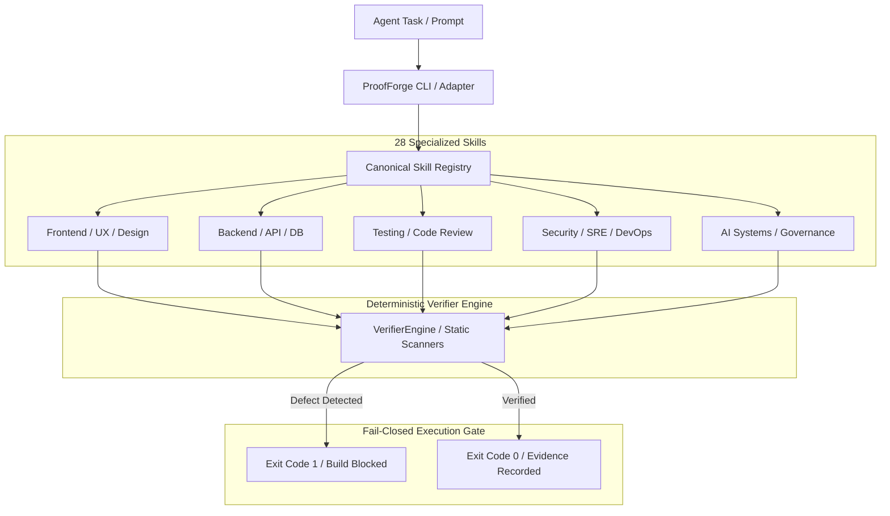

<div align="center">


# ProofForge

### Deterministic AI Engineering Verification & Governance Framework

**Build with AI. Verify with Evidence.**

A deterministic, fail-closed verification framework and engineering skills ecosystem designed for **Google Antigravity** and modern AI coding agents. ProofForge enforces machine verification over unverified assertions, validates architectural and security constraints, detects placeholder code, and provides 28 specialized, machine-audited engineering skills.

[](https://github.com/EyadAbduljalil/ProofForge/tree/v2.1.0)
[](skills/)
[](package.json)
[](skills/security/references/security_matrix.md)
[](https://github.com/EyadAbduljalil/ProofForge/actions/workflows/ci.yml)
[](LICENSE)

**Repository:** [github.com/EyadAbduljalil/ProofForge](https://github.com/EyadAbduljalil/ProofForge) &nbsp;|&nbsp; **Workflow Guide:** [`docs/WORKFLOW_COORDINATION.md`](docs/WORKFLOW_COORDINATION.md)

</div>

---

## 📌 Table of Contents

- [⚡ One-Click AI Skills Adoption Directive](#-one-click-ai-skills-adoption-directive)
- [1. Overview](#1-overview)
- [2. Why ProofForge?](#2-why-proofforge)
- [3. Key Features](#3-key-features)
- [4. System Architecture](#4-system-architecture)
- [5. Skills Ecosystem](#5-skills-ecosystem)
- [6. Verification Model & Evidence Hierarchy](#6-verification-model--evidence-hierarchy)
- [7. Installation](#7-installation)
- [8. Quick Start](#8-quick-start)
- [9. CLI Reference](#9-cli-reference)
- [10. Programmatic API](#10-programmatic-api)
- [11. Project Structure](#11-project-structure)
- [12. Configuration & Environment](#12-configuration--environment)
- [13. Testing and Benchmarks](#13-testing-and-benchmarks)
- [14. Roadmap](#14-roadmap)
- [15. Contributing](#15-contributing)
- [16. Security Policy](#16-security-policy)
- [17. License](#17-license)

---

## ⚡ One-Click AI Skills Adoption Directive

> 💡 **For Google Antigravity, Claude Code, Cursor, Windsurf, Codex, and ChatGPT:**  
> Copy and paste this prompt to your AI coding agent to immediately activate ProofForge's 28 engineering skills, deterministic verification gates, and security governance in **any** workspace:

```text
================================================================================
           PROOFFORGE V2 — ONE-CLICK AGENT SKILLS ADOPTION DIRECTIVE
================================================================================
You are the Lead Software & Security Architect for this workspace, governed by ProofForge.

MANDATORY FIRST STEP:
Clone and activate the official ProofForge 28 engineering skills suite:
git clone https://github.com/EyadAbduljalil/ProofForge.git .proofforge && node .proofforge/bin/proofforge.js skills sync

CORE GOVERNANCE RULES (FAIL-CLOSED):
1. [Security (P0)]: Zero-trust, server-side authorization, anti-IDOR/BOLA, sanitize I/O, validate tenant_id on all queries, timing-safe crypto, and default-deny.
2. [Evidence Contract]: Never claim completion without deterministic machine evidence (terminal exit code 0). No unverified claims or assumed passes.
3. [Anti-Laziness]: Strictly no "// TODO: implement later", no placeholder comments, no truncated implementations, no mock bypasses. Deliver 100% complete production code.
4. [Anti-Slop Craft]: Ban generic AI purple gradients, bloated card grids, and fake metrics. Enforce 4px/8px spatial rhythm, WCAG AAA contrast, semantic tokens, and RTL/LTR parity.
5. [Architecture]: Strict separation of concerns (Clean Architecture). Decouple presentation from storage. Enforce ACID transactions for all multi-step state mutations.

ACTIVE SKILL ACTIVATION:
Whenever working on a task, automatically invoke the relevant specialized ProofForge skill:
- Frontend / UX: skills/frontend, skills/forms, skills/ui-ux, skills/responsive, skills/rtl
- Backend / API: skills/backend, skills/api, skills/database, skills/ecommerce
- Quality & Verification: skills/testing, skills/code-review, skills/anti-laziness, skills/project-audit
- Performance / Polish: skills/performance, skills/motion, skills/taste-craft, skills/anti-slop, skills/design-system
- Security & SRE: skills/security, skills/production-readiness, skills/deployment, skills/architecture, skills/seo
- AI Systems: skills/ai-engineering

VERIFICATION OBLIGATION:
Before reporting any task as done, you MUST execute the corresponding verification script:
e.g. node .proofforge/bin/proofforge.js verify
If any check fails (exit code 1), fix the root cause immediately. Conclude every response with:
1. Security Summary & Trust Boundaries
2. Exact Changes Made (Minimal Safe Diffs)
3. Verifiable Terminal Output / Evidence
================================================================================
```

---

## 1. Overview

**ProofForge** is a deterministic verification framework and modular skills repository for AI-assisted software engineering.

Modern generative AI coding tools produce code rapidly, but they lack built-in mechanisms to verify that their changes adhere to system invariants, maintain database atomicity, or satisfy security requirements. ProofForge bridges this gap: it translates engineering rules and architectural standards into executable, fail-closed verification scripts that audit agent modifications before they reach production.

ProofForge can run as an interactive CLI, execute automated CI checks, or provide native skills directly to **Google Antigravity** via `.agents/skills/`.

---

## 2. Why ProofForge?

AI coding assistants frequently encounter three systematic failure modes:

| Failure Mode | Manifestation | How ProofForge Solves It |
|---|---|---|
| **Unverified Completion** | Declaring tasks "fixed" without running test suites or checking exit codes. | **Deterministic Evidence Gate:** Claims require executable terminal checks (`exit code 0`). |
| **Silent Authorization Flaws** | Introducing IDOR/BOLA, unparameterized database queries, or trusting client-supplied IDs. | **Server-Side Security Invariants:** Scans and verifies multi-tenant isolation and strict role checks. |
| **Code Laziness & Slop** | Inserting `// TODO: implement later` mocks, generic purple gradients, and bloated card grids. | **Automated AST & Pattern Scanners:** Zero-tolerance scanners that fail builds on placeholder comments or design slop. |

---

## 3. Key Features

* **Deterministic Fail-Closed Verifiers:** Written in zero-dependency Node.js. Verifiers return exit code `0` solely when properties are verified, and exit code `1` immediately on defects.
* **28 Antigravity-Native Skills:** Formatted to the Google Antigravity Agent Skills specification, featuring progressive disclosure (`SKILL.md`, `scripts/`, `examples/`, `references/`).
* **Security & ASVS Level 2 Rules:** Automated checks for server-side authorization, timing-safe crypto, CORS/CSRF headers, and tenant isolation keys.
* **Evidence Graph Traceability:** Tracks code modifications, test execution results, and validation claims within an internal structured Evidence Graph.
* **Anti-Slop Visual Intelligence:** Design system rules and linters enforcing WCAG AAA contrast, semantic design tokens, 4px/8px spatial rhythm, and full RTL/LTR bidirectional parity.
* **Differential Skill Synchronization:** Synchronizes canonical skills into local workspace `.agents/skills/` while protecting user-created custom skills from accidental pruning.

---

## 4. System Architecture

ProofForge structures autonomous development into three decoupled tiers:



---

## 5. Skills Ecosystem

The repository provides **28 canonical engineering skills** organized across 8 core disciplines. Each skill contains an Antigravity-compliant `SKILL.md`, practical implementation examples, reference guides, and executable verification scripts:

### A. Frontend Engineering
* [`frontend`](skills/frontend/SKILL.md) — State management, error boundary containment, chunk splitting (< 200KB). *(Verifier: `node skills/frontend/scripts/verify_frontend.js`)*
* [`forms`](skills/forms/SKILL.md) — Zod schema validation, double-submission protection, and accessible inline errors. *(Verifier: `node skills/forms/scripts/verify_forms.js`)*
* [`ui-ux`](skills/ui-ux/SKILL.md) — Five-state UI machine (Idle, Loading, Empty, Error, Success). *(Verifier: `node skills/ui-ux/scripts/verify_ux.js`)*
* [`responsive`](skills/responsive/SKILL.md) — Mobile-first adaptive viewports (320px to 4K), 44x44px touch targets. *(Verifier: `node skills/responsive/scripts/verify_responsive.js`)*
* [`rtl`](skills/rtl/SKILL.md) — Arabic/Hebrew bidirectional layout, CSS logical properties, icon mirroring. *(Verifier: `node skills/rtl/scripts/audit_rtl.js`)*
* [`dashboards`](skills/dashboards/SKILL.md) — High-density analytics, monospace alignment, table virtualization. *(Verifier: `node skills/dashboards/scripts/verify_dashboards.js`)*

### B. Backend Engineering
* [`backend`](skills/backend/SKILL.md) — Routing architecture, `/healthz` & `/readyz` probes, sliding rate-limits. *(Verifier: `node skills/backend/scripts/verify_backend.js`)*
* [`api`](skills/api/SKILL.md) — REST/GraphQL contracts, unified response envelopes (`ApiResponse`), idempotent mutations. *(Verifier: `node skills/api/scripts/verify_api.js`)*

### C. Database Engineering
* [`database`](skills/database/SKILL.md) — ACID transactions, multi-tenant row isolation (`tenant_id`), migration integrity. *(Verifier: `node skills/database/scripts/verify_database.js`)*

### D. Full-Stack & Systems Integration
* [`fullstack`](skills/fullstack/SKILL.md) — Cross-tier feature lifecycles, API-to-DB integration, end-to-end consistency. *(Verifier: `node skills/fullstack/scripts/verify_fullstack.js`)*
* [`ecommerce`](skills/ecommerce/SKILL.md) — Atomic stock reservation, double-spend prevention, timing-safe webhook HMAC. *(Verifier: `node skills/ecommerce/scripts/verify_ecommerce.js`)*
* [`image-to-code`](skills/image-to-code/SKILL.md) — Converting UI mockups into production React/Tailwind without visual hallucination. *(Verifier: `node skills/image-to-code/scripts/verify_image_code.js`)*

### E. Software Quality Engineering
* [`testing`](skills/testing/SKILL.md) — Deterministic unit/integration/E2E testing and Evidence Contract enforcement. *(Verifier: `node skills/testing/scripts/verify_evidence.js`)*
* [`code-review`](skills/code-review/SKILL.md) — Adversarial review, dangerous API detection, side-effect checking. *(Verifier: `node skills/code-review/scripts/review_code.js`)*
* [`anti-laziness`](skills/anti-laziness/SKILL.md) — Scanning and banning `// TODO` placeholders, empty catch blocks, and mocked logic. *(Verifier: `node skills/anti-laziness/scripts/scan_laziness.js`)*
* [`project-audit`](skills/project-audit/SKILL.md) — Composite multi-domain diagnostic executing 14 verifiers in sequence. *(Verifier: `node skills/project-audit/scripts/run_audit.js`)*

### F. Performance & Visual Craft
* [`performance`](skills/performance/SKILL.md) — Google Core Web Vitals optimization (< 2.5s LCP, < 200ms INP, < 0.1 CLS). *(Verifier: `node skills/performance/scripts/audit_performance.js`)*
* [`motion`](skills/motion/SKILL.md) — 60fps GPU-accelerated transforms (`translate/opacity`), reduced-motion support. *(Verifier: `node skills/motion/scripts/audit_motion.js`)*
* [`taste-craft`](skills/taste-craft/SKILL.md) — Tactile button states (`:active`), subtle borders, refined micro-interactions. *(Verifier: `node skills/taste-craft/scripts/audit_craft.js`)*
* [`anti-slop`](skills/anti-slop/SKILL.md) — Elimination of generic AI visual tropes (purple gradients, bloated cards). *(Verifier: `node skills/anti-slop/scripts/audit_slop.js`)*
* [`design-system`](skills/design-system/SKILL.md) — 4px/8px spatial rhythm, design tokens, WCAG AAA contrast scales. *(Verifier: `node skills/design-system/scripts/verify_tokens.js`)*

### G. DevOps & Production Reliability
* [`accessibility`](skills/accessibility/SKILL.md) — WCAG 2.2 AA/AAA compliance, screen reader ARIA labels, focus traps. *(Verifier: `node skills/accessibility/scripts/audit_a11y.js`)*
* [`security`](skills/security/SKILL.md) — OWASP ASVS L2 rules, input sanitization, CSRF tokens, timing-safe crypto. *(Verifier: `node skills/security/scripts/verify_security.js`)*
* [`deployment`](skills/deployment/SKILL.md) — Multi-stage non-root Dockerfiles, frozen lockfile builds, zero leaked secrets. *(Verifier: `node skills/deployment/scripts/verify_deployment.js`)*
* [`production-readiness`](skills/production-readiness/SKILL.md) — 12-Factor compliance, structured JSON logging, process supervision. *(Verifier: `node skills/production-readiness/scripts/audit_readiness.js`)*
* [`architecture`](skills/architecture/SKILL.md) — Clean Architecture boundaries and Architecture Decision Records (ADR). *(Verifier: `node skills/architecture/scripts/verify_architecture.js`)*
* [`seo`](skills/seo/SKILL.md) — Semantic HTML5 headings, OpenGraph metadata, JSON-LD structured schemas. *(Verifier: `node skills/seo/scripts/verify_seo.js`)*

### H. AI Engineering & Agent Systems
* [`ai-engineering`](skills/ai-engineering/SKILL.md) — AI agent tool permission governance, prompt injection defense, structured JSON outputs. *(Verifier: `node skills/ai-engineering/scripts/verify_ai_engineering.js`)*

---

## 6. Verification Model & Evidence Hierarchy

ProofForge enforces a strict distinction between natural language claims and machine evidence:

```
[State 0] AI_CLAIMED         → Agent asserts an issue was resolved (Untrusted / Rejected)
    ↓
[State 1] CODE_CHANGED       → File modification verified on disk via static inspection
    ↓
[State 2] TEST_PASSED        → Automated test suite passes with terminal exit code 0
    ↓
[State 3] EVIDENCE_CAPTURED  → Real terminal output, file hashes, and AST traces recorded
    ↓
[State 4] PROOFFORGE_VERIFIED → Machine-certified and appended to the Evidence Graph
```

**Fail-Closed Rule:** If any check fails, the process exits with `code 1`. The agent must resolve the defect rather than assuming completion.

---

## 7. Installation

### Option A: Local Clone (Recommended for Antigravity & v2.x Features)
The canonical v2.x source code, complete 28-skill library, and scenario benchmark suite are maintained directly in the Git repository:

```bash
# 1. Clone the repository
git clone https://github.com/EyadAbduljalil/ProofForge.git
cd ProofForge

# 2. Install development dependencies
npm install

# 3. Synchronize skills to Google Antigravity (.agents/skills/)
node bin/proofforge.js skills sync
```

### Option B: npm Package Installation
ProofForge is also published on npm (base package version `1.0.4`):
```bash
npm install proofforge
```
*(Note: To use the complete v2.x Antigravity skills suite and realistic scenario benchmarks, clone directly from GitHub).*

---

## 8. Quick Start

### 1. Verify Project Installation
Confirm that your local environment passes the complete package and E2E regression suite:
```bash
npm test
```

### 2. Run the Multi-Domain Project Audit
Execute all 14 domain verifiers against your workspace:
```bash
node bin/proofforge.js verify
```

### 3. List and Inspect Available Skills
```bash
# List all 28 canonical skills
node bin/proofforge.js skills list

# Inspect a specific skill
node bin/proofforge.js skills inspect frontend
```

---

## 9. CLI Reference

ProofForge exposes its command-line interface through `bin/proofforge.js` (and `bin/webforge.js`):

### Skill Management
```bash
# List all canonical skills and their validity status
node bin/proofforge.js skills list

# Inspect detailed frontmatter, scripts, examples, and references
node bin/proofforge.js skills inspect <skill-name>

# Validate structural integrity and YAML frontmatter against Antigravity specs
node bin/proofforge.js skills validate

# Execute the 28-skill structural & script quality benchmark
node bin/proofforge.js skills benchmark

# Synchronize canonical skills to .agents/skills/ in the current workspace
node bin/proofforge.js skills sync [targetDir]

# Preview synchronization without copying files
node bin/proofforge.js skills sync -- --dry-run

# Diff installed workspace skills against the canonical repository
node bin/proofforge.js skills diff [targetDir]

# Prune stale ProofForge skills while preserving custom user skills
node bin/proofforge.js skills prune [targetDir] --force
```

### Verification & Testing
```bash
# Run the composite multi-domain project diagnostic
node bin/proofforge.js verify

# Output machine-readable JSON verification results for CI pipelines
node bin/proofforge.js verify --json

# Run all automated test suites
node bin/proofforge.js test

# Run the realistic scenario benchmark runner
node bin/proofforge.js benchmark:scenarios

# Display the latest certified verification report
node bin/proofforge.js report
```

---

## 10. Programmatic API

ProofForge exports its core contracts, path guards, and execution engines for integration into custom harnesses:

```javascript
const {
    ProofRunEngine,
    PathLoaderGuard,
    AntigravityAdapter
} = require('./packages/contracts');

// 1. Execute a Bounded Verification Run
const engine = new ProofRunEngine();
const result = engine.executeBoundedRun({
    request: 'Verify user authentication & tenant isolation',
    projectName: 'CoreAPI'
});

console.log('Run Status:', result.status);       // 'VERIFIED'
console.log('Exit Code:', result.exit_code);     // 0

// 2. Validate Paths Securely (Anti-Path Traversal)
const pathCheck = PathLoaderGuard.validateSafePath('registry/agents.json', process.cwd());
console.log('Safe Path:', pathCheck);

// 3. Programmatic Antigravity Skill Synchronization
const syncReport = AntigravityAdapter.syncCanonicalSkills('skills', '.agents/skills', {
    dryRun: false,
    force: true
});
console.log(`Synced ${syncReport.synced.length} skills into Antigravity.`);
```

### Custom Verifiers via `VerifierEngine`

You can build custom static verifiers using the internal `VerifierEngine`:

```javascript
const VerifierEngine = require('./packages/contracts/verifier-engine');

const verifier = new VerifierEngine('custom-security-audit');
const serverFiles = verifier.findFiles('apps/server', ['.js']);

// Perform real file checks
serverFiles.forEach(file => {
    const content = verifier.readFile(file);
    const hasHealthProbe = content.includes('/healthz');
    verifier.recordCheck('LIVENESS_PROBE_EXISTS', hasHealthProbe, file, 'CRITICAL');
});

// Finish verification: prints report and exits with 0 (pass) or 1 (fail)
verifier.finish();
```

---

## 11. Project Structure

```text
ProofForge/
├── .agents/skills/               # Synchronized Google Antigravity native skills
├── bin/
│   ├── proofforge.js             # Canonical ProofForge CLI
│   └── webforge.js               # Autonomous engineering CLI & server runner
├── skills/                       # 28 Canonical Engineering Skills
│   ├── [skill-name]/
│   │   ├── SKILL.md              # Skill contract, identity, rules & instructions
│   │   ├── scripts/              # Executable, zero-dependency Node.js verifiers
│   │   ├── examples/             # Concrete reference implementations
│   │   └── references/           # In-depth architectural & security guidelines
├── packages/
│   ├── contracts/                # Verification engine, Antigravity adapter, registries
│   ├── security/                 # ASVS controls, IDOR guards, and timing-safe crypto
│   ├── security-governance/      # Threat modeling, attack surface, and supply chain guards
│   ├── orchestration/            # Evidence Graph, claim engines, and compliance rules
│   ├── design-system/            # Design tokens, spatial rhythm, and contrast validators
│   └── infrastructure/           # Storage adapters and ACID migration runners
├── tests/
│   ├── benchmark/                # Realistic multi-domain scenario benchmarks
│   ├── fixtures/                 # Broken & vulnerable test fixtures (negative controls)
│   └── e2e/                      # Live HTTP integration and security test suites
├── docs/                         # Cross-skill workflow and orchestration documentation
├── GEMINI.md                     # Project-level rules for Google Antigravity / Gemini
├── AGENTS.md                     # Universal agent engineering protocols
└── package.json                  # Project manifest, dependencies, and scripts
```

---

## 12. Configuration & Environment

| Variable | Default | Purpose |
|---|---|---|
| `TARGET_DIR` | `process.cwd()` | Root directory scanned by the verifiers |
| `NODE_ENV` | `development` | Runtime environment (`development`, `test`, `production`) |
| `PORT` | `3000` | Port used by the built-in server (`proofforge serve`) |
| `CI` | `false` | When `true`, enforces strict fail-closed exit codes in pipelines |

---

## 13. Testing and Benchmarks

ProofForge validates its own verification capabilities across four testing tiers:

### 1. Regression & Unit Tests
```bash
npm test
```
Executes all package tests, state machine verifiers, and live HTTP E2E tests against local endpoints.

### 2. Structural Skill Quality Benchmark
```bash
npm run benchmark:skills
```
Audits all 28 skills in `skills/` to confirm:
* Valid directory structure (`SKILL.md`, `scripts/`, `examples/`, `references/`).
* Valid YAML frontmatter with `lowercase-hyphenated` names and semantic descriptions.
* Presence of required sections (Purpose, Methodology, Evidence).
* Execution of each skill's primary verification script with `--json` returning `exit code 0`.

*(Note: This benchmark validates structural and script execution validity; it does not evaluate live LLM reasoning or prompt quality against human benchmarks).*

### 3. Realistic Scenarios Benchmark (Negative Controls)
```bash
npm run benchmark:scenarios
```
Tests the verification engines against deliberate flaws in `tests/fixtures/` to verify fail-closed behavior:
1. **Broken Frontend (`tests/fixtures/broken-frontend`):** Confirms that missing `alt` attributes, unlabelled inputs, and rigid `850px` layout containers fail with `exit code 1`.
2. **Insecure Backend (`tests/fixtures/insecure-backend`):** Confirms that omitted `/healthz` probes, missing security headers, and lack of rate-limits fail with `exit code 1`.
3. **Flawed Database (`tests/fixtures/flawed-database`):** Confirms that omitted `tenant_id` isolation keys and non-atomic data updates fail with `exit code 1`.
4. **Hardened Production:** Confirms that a hardened, ASVS L2-compliant project passes all 14 domain verifiers with a composite score of `100/100` and `exit code 0`.

---

## 14. Roadmap

### Completed (v2.1.0)
- [x] Full restructuring of all 28 canonical Antigravity skills.
- [x] Canonical `VerifierEngine` with deterministic AST/regex file scanning.
- [x] Google Antigravity native synchronization (`.agents/skills/`) with differential pruning.
- [x] 14-domain automated multi-check project audit (`run_audit.js`).
- [x] Negative-control scenario benchmarks (`broken-frontend`, `insecure-backend`, `flawed-database`).
- [x] Cross-skill orchestration guide ([`docs/WORKFLOW_COORDINATION.md`](docs/WORKFLOW_COORDINATION.md)).
- [x] Extended CLI subcommands under `proofforge skills *`.

### In Progress
- [ ] Language server protocol (LSP) diagnostic plugin for live editor feedback.
- [ ] Interactive HTML report exporter for multi-project CI dashboards.

### Planned
- [ ] Integration adapters for custom remote agent runners.
- [ ] Asymmetric cryptographic key signing (ECDSA) for exported evidence packages.

---

## 15. Contributing

Contributions to ProofForge are welcome! Before submitting a pull request, please review [`CONTRIBUTING.md`](CONTRIBUTING.md).

All contributions must satisfy:
1. **The Skill Quality Contract:** Any new skill must include `SKILL.md`, `scripts/`, `examples/`, and `references/`.
2. **Deterministic Verification:** Verifiers must perform real inspections and exit with code `1` on defects.
3. **Zero False Claims:** Tests and verifiers must not output hardcoded passes or assumed results.
4. **Clean Regression:** All changes must pass `npm test` and `npm run benchmark:skills`.

---

## 16. Security Policy

Security is a primary pillar of ProofForge. For responsible disclosure procedures and vulnerability reporting, please see [`SECURITY.md`](SECURITY.md).

* **Supported Versions:** `2.x`, `1.x`
* **Vulnerability Reporting:** Submit private reports via GitHub Security Advisories (`Security > Vulnerability reporting`).

---

## 17. License

ProofForge is open-source software licensed under the [MIT License](LICENSE).
